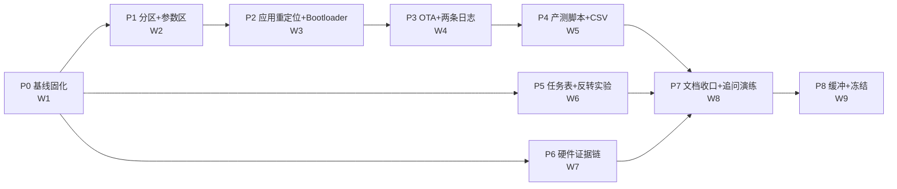

# T1 执行计划（2026-11-16 → 2027-01-17，本学期内交付）

> 计划表原文：**2.2 T1｜现在 – 2027.06（大二下）：把“学过”变成“交付过”**
> 原则：**不学新东西，把已有的两个项目变成证据。**
>
> 本计划按你的要求改写时间口径：**起点 = 今天 2026-11-16（周一，大二上），终点 = 本学期末 2027-01-17（周日）**，共 9 个自然周。
> 本文只定计划与验收口径，不改功能代码；第一批的实测证据见同目录《02-仓库缺口清单.md》。

---

## 0. 一页结论

| 项目 | 现状（2026-11-16 实测） | 判断 |
|---|---|---|
| 干净检出能否编译 | HEAD `9c9c37b` 用 `git archive` 导出到工作区外，Debug / Release / MinSizeRel 三构型全部 PASS | ✅ 底子在，可以作为“干净检出可编”的证据 |
| 固件体积 | Debug(-Og) 48,120 B / 64 KB（73.4%）；MinSizeRel **43,440 B（66.3%）**；Release 51,124 B（78%，实际被 `-O3` 覆盖） | ⚠️ 还有余量，但 Release 构型不可用于发布 |
| RAM | 14,480 B / 20,480 B（70.7%），链接后主栈余 **6,008 B** | ✅ 够用，但放不下整包 OTA 缓冲 |
| 四行任务 | 第 1 行（Bootloader/分区/参数/产测）**零实现**；第 2 行只有代码事实、无文档和实测；第 3 行无任何波形证据；第 4 行无 README、无接口文档 | ❌ 四行都还没形成“证据” |
| 最大硬约束 | 64 KB 单区，**装不下 A/B 双槽**（2×43.4 KB = 86.8 KB） | 决定 OTA 只能“单槽 + 失败重传”，必须写进已知限制 |
| 最便宜的高价值动作 | 第 4 行（README/接口/任务表/文档纠偏）不占板子、不依赖硬件 | **W1 就做，先拿分** |

**排序原则：先固化基线（W1）→ 再做依赖硬件的第 1 行（W2–W5）→ 第 2 行（W6）→ 第 3 行（W7）→ 收口（W8–W9）。**
第 4 行不是最后做，而是“W1 先做最小版，W8 再定稿”。

---

## 1. 四行任务 → 验收物 → 面试追问靶心

| # | 计划表任务 | 最终验收物（可打开、可复现） | 30 分钟追问会打在哪 | 依赖 |
|---|---|---|---|---|
| 1 | 平衡车 v2：分区 + Bootloader + 参数区 + 产测脚本 | ①《分区表》一页（地址/大小/余量/断言）②两条升级日志（成功 / CRC 拒绝）③一份产测 CSV 报告 | 为什么这么分区；单槽掉电怎么办；CRC 失败后旧固件还在吗；A/B 参数区怎么保证不丢；Boot 怎么跳、MSP/VTOR 怎么设；页擦除与 IWDG 怎么共存；产测项怎么证明不是“假 PASS” | W2→W3→W4→W5 |
| 2 | 平衡车拆任务 + 优先级反转实验 | ①任务表（栈/优先级/触发/周期/IPC/共享资源/实测水位）②一次反转现象记录（前后数据 + 说明） | 优先级为什么这么排；栈大小依据；反转现象怎么测出来；优先级继承改了什么；互斥锁与临界区的取舍；ISR 里为什么不能拿互斥锁 | W1 起稿，W6 定稿 |
| 3 | 一条硬件联调证据链 | ①示波器波形截图（至少 1 组，建议 3 组）②「现象→假设→测量→结论」一页纸 | 探头接哪、为什么接这；波形每个沿说明什么；怎么排除“是探头/量程问题”；如何用寄存器/计数器交叉验证 | W7（可提前穿插） |
| 4 | 代码与文档整理 | ①干净检出可编（脚本 + 结果）②README 5 分钟跑通 ③模块接口说明 | 陌生人能否照 README 跑通；接口的单位/调用上下文/是否阻塞/ISR 是否安全；为什么删这些死代码 | W1 最小版，W8 定稿 |

> 说明：T1 主战场是 `CARTESTFreertos`。`FreertosGUILab`（示波器项目）本轮只做“README + 干净检出”同规格对齐，不新增功能，安排在 W8，避免分散板子时间。

---

## 2. 批次与依赖关系

| 批次 | 周次 | 是否占板子 | 是否占示波器 | 前置 |
|---|---|---|---|---|
| P0 基线固化 | W1 | 只在验证 `app_rc.c` 时需要 | 否 | 无 |
| P1 分区 + 参数区 | W2 | 是 | 否 | P0（尺寸基线与 .bin 生成） |
| P2 重定位 + Bootloader | W3 | 是 | 否 | P1（参数区地址先定） |
| P3 OTA + 日志 | W4 | 是 | 否 | P2（Boot 能跳、能收） |
| P4 产测 + CSV | W5 | 是 | 否 | P3（串口命令框架复用） |
| P5 任务表 + 反转 | W6 | 是（30 min 跑机） | 建议（测等待时间） | P0（任务表事实） |
| P6 硬件证据链 | W7 | 是 | **必须** | P0（固件能跑） |
| P7 文档收口 | W8 | 仅复验 | 否 | P1–P6 |
| P8 缓冲 | W9 | 仅复验 | 否 | P7 |

> P5/P6 与 P1–P4 无代码依赖，如果某周板子被占用，可把 P5/P6 与当周批次对调；但 **P1→P2→P3→P4 的顺序不能乱**。

---

## 3. 周计划与每周检查点

> 检查点必须是“当场能打开看”的东西（文件、日志、截图、命令输出），不接受“感觉做完了”。

### W1｜11/16–11/22｜P0 基线固化（纯桌面，不占板子）

**做什么**
1. 验证并提交工作区里未提交的 `Core/Src/app_rc.c` 改动（错误回调清标志 + 按 `RxState` 重装）；上板收发一次蓝牙，确认不复发；补变更记录。
2. 新建 `README.md`：工具链版本、`cmake --preset`、构建、烧录、串口现象（`B1` / `12345abcdef6789AB2` / MemMon 表）。
3. 新建 `docs/任务表.md`：按代码事实写 7 个任务 + IPC + 中断优先级表。
4. 修正文档漂移：`docs/FreeRTOSConfig_配置解析.md`（`configUSE_TIMERS` 实际 0、堆实际 9728）、`docs/内存分布_FLASH_RAM与全局变量.md`（当前 RAM 14,480 B、`.data` 104 B）；新建 `docs/索引.md`。
5. 新建 `docs/构建基线.md`：三构型 FLASH/RAM 实测 + 干净导出命令；打 tag `baseline-2026-11-16`。

**周末检查点**
- 工作区 `git status` 干净；`git archive` 导出后三构型构建 PASS（有日志/截图）。
- 按 README 从零配置的机器能跑通（先自己按步骤复走一遍，W8 再找同学实测）。
- `docs/任务表.md` 覆盖 motor/ctrl/att/rc/UART2_TX/MemMon/idle 七行，且每行的栈和优先级与 `main.c` 一致。
- 文档里不再出现“heap 7680 / timers 1”这类与代码冲突的数字。

---

### W2｜11/23–11/29｜P1 分区表 + 参数区（app 地址暂不动）

**做什么**
1. 写《分区表》v1：Boot 8 KB / App 54 KB / Param 2×1 KB（末两页），含编译期 `ASSERT` 方案与余量计算（见缺口清单第 6 节）。
2. 新增 `app_param.c/h`：A/B 双页、魔数 + 版本 + 序号 + CRC32、默认值回退；软件 CRC32（HAL CRC 模块当前未启用）。
3. CMake 增加 `.bin` 生成（`objcopy -O binary`），OTA 与产测都要用。
4. 上板测试：参数写入/读取、A 页破坏后从 B 页恢复、连续写 100 次。

**周末检查点**
- 参数连续写 100 次无丢；人为写坏 A 页后能回退 B 页（有串口日志）。
- 构建目录产出 `.bin`，大小与 `.elf` 的 FLASH 占用一致。
- App 仍在 `0x08000000`，原有功能不受影响（`B1/B2`、遥控、平衡）。

---

### W3｜11/30–12/06｜P2 应用重定位 + 最小 Bootloader

**做什么**
1. App 链接到 `0x08002000`，长度 54 KB；启用向量表重定位（`VECT_TAB_OFFSET` 或启动时写 `SCB->VTOR`）。
2. Bootloader 工程（独立 target）：裸机 USART2（921600）、读参数、启动计数、3 秒升级窗口、跳转 App；**不使用 FreeRTOS 与现有 DMA 驱动**。
3. Boot 体积预算 8 KB，构建后自动打印并断言。
4. 建立“烧录顺序”说明（先 App 后 Boot，或合并 hex）。

**周末检查点**
- 上电顺序：Boot 版本日志 → 跳 App → `B1` → `12345abcdef6789AB2` → MemMon 正常。
- 用 SWD 分别烧写 Boot 和 App 都能工作；擦掉 App 后 Boot 停在升级窗口（有日志）。
- Boot 实测体积 ≤ 8 KB；若 ≤ 4 KB，记录“可切到分区方案 B”的结论。

---

### W4｜12/07–12/13｜P3 OTA + 两条升级日志

**做什么**
1. 升级协议：帧头/序号/长度/CRC16 + 末尾整包 CRC32；1 KB 页对齐写入；丢包重传；每页喂 IWDG。
2. 镜像头：魔数、版本、长度、CRC32；升级标志放参数区。
3. PC 工具 `tools/ota/ota.py`：串口发 `.bin`、显示进度与结果。
4. 造两种日志：成功升级一次；故意发错 CRC（或截断）一次，记录拒绝过程。

**周末检查点**
- 旧版本 → 新版本升级成功，版本号在 Boot/App 日志中可核对。
- CRC 错误时 Boot 打印“拒绝 + 原因”，设备停在升级模式并可重传成功。
- 升级中途拔电后，重新上电可再次升级（有记录）。
- `docs/evidence/升级日志_成功.md`、`升级日志_CRC拒绝.md` 两份归档。

---

### W5｜12/14–12/20｜P4 产测脚本 + CSV

**做什么**
1. App 增加产测命令集（USART2 文本协议，`KEY=VALUE` 输出，便于 CSV）：`ping`、`info`、`test imu`、`test encoder`、`test motor`、`test bat`、`test param`。
2. PC 工具 `tools/production_test/production_test.py`：串口发现、逐项执行、超时判定、CSV 落盘（SN/时间/项/数值/判定）。
3. 失败注入：拔 MPU6050、挡住编码器，确认对应项 FAIL 而不是“假 PASS”。

**周末检查点**
- 一条命令跑完 6 项，生成可打开的 CSV（含至少 1 份全 PASS、1 份含 FAIL）。
- 产测不触发参数区写入时的电机抖动（写参数只在停机状态）。
- 与 OTA 共用 USART2 时不互相抢（启动 3 秒窗口 + 命令区分）。

---

### W6｜12/21–12/27｜P5 任务表定稿 + 优先级反转实验

**做什么**
1. 跑机 30 分钟，抓 MemMon 打印，把每个任务的实测最小剩余栈填进任务表；按“剩余 20–30% 余量”原则调栈，**保持总堆不变**。
2. 反转实验（独立 demo target 或分支，不进发布 App）：L/M/H 三任务共享一把互斥锁；H 等锁时间用 DWT 打点 + GPIO 脉冲输出，示波器测高电平宽度；对比“无优先级继承（二值信号量）”与“有优先级继承（mutex）”。
3. 写 `docs/evidence/优先级反转实验.md`：现象、假设、测量方法、前后数据、结论。

**周末检查点**
- 任务表里每个任务同时有“设计值”和“实测水位”。
- 反转可复现：给出 before/after 两组等待时间数值与波形。
- 能解释 `configUSE_MUTEXES=1` 但当前代码 0 个 mutex 的现状与实验差异。

---

### W7｜12/28–01/03｜P6 一条硬件联调证据链

**做什么**
1. 三组波形（时间/幅值/探头比记录清楚）：
   - PWM：PA8（TIM1_CH1，左）/ PB6（TIM4_CH1，右），10 kHz，占空比随 `App_PWM_Set_L/R` 变化；
   - I2C：PB8/PB9，400 kHz，读 MPU6050 14 字节的完整帧；
   - USART2：PA2，921600，DMA 发送一帧的时间与内容对应；编码器 PB3/PB14 边沿与速度计算对应。
2. 每组写一页纸：现象 → 假设 → 测量（探头/量程/触发）→ 结论 → 还排除了什么。
3. 截图归档 `docs/evidence/`，并在索引里列出。

**周末检查点**
- 至少 1 组完整“现象→假设→测量→结论”，建议 3 组。
- 截图能看清时间轴与幅值；每张图能指出“这个沿/这段间隔说明什么”。
- 能回答“如果不接示波器，用哪个寄存器/计数器也能验证同一件事”。

---

### W8｜01/04–01/10｜P7 文档收口 + 30 分钟追问演练

**做什么**
1. README 定稿：5 分钟跑通、目录结构、任务/中断架构图、已知限制（单槽 OTA 无回滚、参数写入会停 CPU 等）。
2. 模块接口说明：每个 `.h` 写清输入/输出单位、调用上下文（任务/ISR）、是否阻塞、失败语义、可重入性。
3. 证据索引：四行验收物各自链接到具体文件/日志/截图。
4. 四行各准备 8 个追问并自测（只出题、不代答）。
5. `FreertosGUILab` 按同一 README 规格补齐（若时间紧，只做干净检出 + 5 分钟跑通）。

**周末检查点**
- 找一位同学按 README 独立跑通（记录卡在哪一步）。
- 四行各 8 问，能连续答 30 分钟不翻代码；答不出的当场标红，进 W9。
- 文档中所有数字与当前构建输出一致（用脚本核对）。

---

### W9｜01/11–01/17｜P8 缓冲与冻结

**做什么**
- 只修 W8 暴露的问题，不加新功能。
- 打 tag `v2.0-t1`；冻结 `docs/evidence/`；输出一页“四行验收物清单”。

**周末检查点**
- 四份验收物可从 README 一键定位。
- 干净检出 + 三构型构建仍 PASS。

---

## 4. 批次执行规则（沿用你已有的工程约束）

1. **一批一提交**：代码与文档分开提交；Conventional Commits 中文描述；只 `git add` 本批文件；提交前 `git status` 确认范围。
2. **每批必须写变更记录**：改前 / 改后 / 原因 / 验证方式与结果；文档放在 `docs/变更记录_*.md`。
3. **每批结束做干净导出构建**：`git archive` 到工作区外临时目录 → `cmake --preset Debug` / `MinSizeRel`，确认不依赖工作区残留。
4. **不改无关代码**：批次卡里写清“允许改动的文件”，超出即停。
5. **每批汇报固定格式**：本批提交号 / 修改文件 / 验收结果 / 残留风险 / 下一批内容。
6. **尺寸红线**：发布构型用 MinSizeRel；任何批次合入前记录 FLASH/RAM，App 区域余量低于 4 KB 时暂停加功能。

---

## 5. 需要你拍板的决策点

| 编号 | 决策 | 选项 | 建议 | 影响 |
|---|---|---|---|---|
| D1 | 分区方案 | A：Boot 8 KB + App 54 KB + Param 2 KB；B：Boot 4 KB + App 58 KB + Param 2 KB | **A**，W3 实测 Boot ≤4 KB 再考虑切 B | 决定 App 余量（A：MinSizeRel 余 11.9 KB；B：余 16.0 KB）与 Boot 开发难度 |
| D2 | OTA 回滚策略 | ①单槽可重传（旧固件会被覆盖）；②把 App 压到约 26 KB 做 A/B 双槽 | **①**，并写进 README「已知限制」 | 决定“掉电/CRC 失败”的面试答法，也决定产测与升级流程 |
| D3 | 产测/升级入口 | USART2 921600 文本协议 / 蓝牙 USART3 9600 | **USART2** | 9600 传 40 KB 固件约 40 s 以上，且占用遥控口 |
| D4 | 反转实验代码归属 | 独立 demo target/分支 / 混进主 App | **独立** | 主 App 只剩 7–12 KB 余量，实验代码不应进发布镜像 |

> 若你在 W2 开始前没有回复，我按“建议”列执行，并在批次汇报里标注为“默认决策”。

---

## 6. 主要风险与应对

| 风险 | 触发条件 | 应对 |
|---|---|---|
| Flash 余量不足 | App 继续加功能，Debug 构型余量只有 7.2 KB | 发布用 MinSizeRel；每批记录尺寸；最后手段是去掉 `qmath.c` 的 8 KB 查表（改为 `sinf`/`atan2f`，需实测控制周期） |
| Release 构型“越大越怪” | 直接 `cmake --preset Release` 得到 51.1 KB | 发布统一用 MinSizeRel；README 写明原因（`-O3` 追加在 `-Os` 之后） |
| 单槽 OTA 断电 | 擦写中途掉电 | Boot 常驻 + 参数区记录“升级中”；上电检测无效镜像 → 停在升级窗口等待重传，不变砖 |
| 页擦除卡住 1 ms 电机环 | 运行期写参数 | 参数写入只在停机/启动阶段；产测写参数项强制先断电机 |
| IWDG 复位 | 升级时页擦除累计超过 410 ms | 每页擦写后喂狗；Boot 用 DWT 延时，不用 `HAL_Delay` |
| CubeMX 重新生成覆盖 | 改 `.ioc` 后生成代码 | 生成后人工检查 `cmake/stm32cubemx/CMakeLists.txt` 与 `stm32f1xx_it.c`（`SVC/PendSV` 重复定义） |
| 板子/示波器时间不确定 | 实验周冲突 | P5/P6 可与其他周对调；纯文档批次（W1/W8）不占硬件 |
| 文档再次漂移 | 改了代码没改数字 | W8 用脚本从构建输出/代码里核对关键数字；每批变更记录包含“影响到的文档” |

---

## 7. 本周（W1）立即执行的 5 件事

1. 上板验证 `Core/Src/app_rc.c` 未提交改动（蓝牙收发 10 帧、拔插一次），通过则提交并补 `docs/变更记录_USART3错误回调.md`；不通过则回退并记录原因。
2. 写 `README.md`（含三构型命令、烧录步骤、上电日志对照）。
3. 写 `docs/任务表.md`（7 行任务 + IPC + 中断表，标注“待实测”字段）。
4. 修 2 份漂移文档 + 建 `docs/索引.md`。
5. 记录三构型尺寸到 `docs/构建基线.md`；打 tag `baseline-2026-11-16`。

**W1 验收口径（一句话）**：一个陌生人拿到仓库，只读 README 就能在 5 分钟内完成“配置→构建→烧录→看到 MemMon 表”，且仓库里没有与代码冲突的文档数字。

---

## 附：本计划引用的实测数据

| 构型 | 命令 | FLASH | RAM | 说明 |
|---|---|---|---|---|
| Debug | `cmake --preset Debug && cmake --build --preset Debug` | 48,120 B（73.42%） | 14,480 B（70.70%） | `-Og -g3`，日常调试 |
| Release | `cmake --preset Release && cmake --build --preset Release` | 51,124 B（78.00%） | 14,480 B | 实际生效 `-O3`，不建议发布 |
| MinSizeRel | `cmake --preset MinSizeRel && cmake --build --preset MinSizeRel` | **43,440 B（66.28%）** | 14,480 B | `-Os -DNDEBUG`，发布/分区预算基准 |

数据来源：2026-11-16 将 `git archive HEAD` 导出到工作区外临时目录后实测；详见《02-仓库缺口清单.md》第 6 节与附录。
